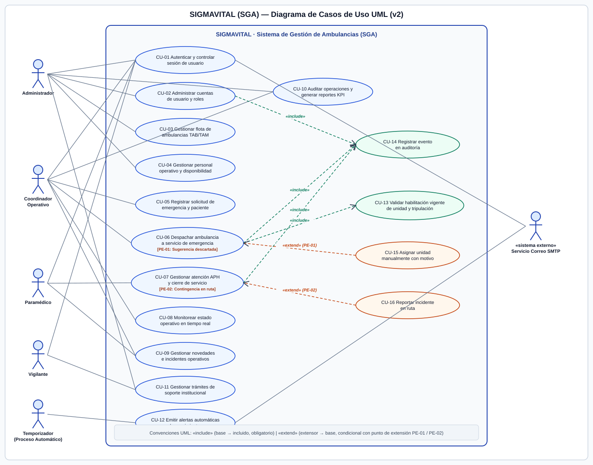

# Guide 1 · Product 1: Analysis Plan and UML Use Case Model (English Version)

**Author:** `@darkid8` · **Ficha:** `3413974` (SENA — Software Analysis and Development)  
**Case Study:** **SIGMAVITAL — Ambulance Management System (SGA)**  
**Source SRS:** [SRS_SIGMAVITAL_SGA.md](../../../../02-requirements/04-evidence-learning/SRS_SIGMAVITAL_SGA.md)

---

## 1. Solution Characterization

| Mandatory Dimension | Specific Characterization for SIGMAVITAL (SGA) |
|---|---|
| **Project Type** | Mission-critical web application for Prehospital Emergency Care (APH), managing emergency requests, Basic (`TAB`) and Medicalized (`TAM`) ambulance dispatch, and real-time operational monitoring under **Colombian Resolution 3100 of 2017** (REPS) and **Law 1581 of 2012** (Personal Data Protection). |
| **Team Size** | Small cross-functional team of **4 developers** (Backend `@darkid8`, Frontend, Fullstack, and Scrum Master) plus **1 Product Owner / Instructor**. |
| **Requirements Stability** | **Mixed / Medium-High:** Core regulatory rules (`TAB`/`TAM` licensing, state lifecycle traceability, immutable audit logs, business rules `RN-001` to `RN-010`) are stable; however, real-time monitoring dashboards, visual alerts, and KPI reporting layouts evolve iteratively. |
| **Client / PO Availability** | **Partial and Periodic:** The Product Owner and institutional stakeholders are not available full-time on-site, participating instead in scheduled weekly validation and review sessions. |

---

## 2. Software Development Methodology Comparison and Selection

| Methodology | Fit for Small Team (4 devs) | Handling Mixed Requirements (Regulatory Core + Iterative UI) | Fit for Partial Client Availability | Regulatory Traceability (REPS / Res. 3100) | Decision |
|---|---|---|---|---|---|
| **RUP** | Medium: heavy ceremony and specialized roles overload a 4-person team. | Medium-High: strong use-case and architecture focus, but slow for rapid UI changes. | High: phase-gate reviews work without daily client presence. | **Very High:** comprehensive formal artifacts. | Discarded as standalone framework due to documentation overhead. |
| **Scrum** | **Very High:** designed for 3–9 person self-organizing teams. | **Very High:** prioritized *Product Backlog* delivers core APH dispatch first, then support modules. | **Very High:** structures PO interaction around *Sprint Planning* and *Sprint Review*. | Medium-High: requires explicit reinforcement with SRS/UML traceability matrices. | **Selected Base** (hybridized with formal analysis traceability). |
| **XP (Extreme Programming)** | High: suits small teams well. | High: great for evolving code, weak on upfront regulatory modeling. | **Low:** requires an *On-Site Customer* available continuously, which is unavailable here. | Low: prioritizes code/tests over formal specification documents. | Discarded due to continuous on-site client requirement. |
| **RAD** | Medium: relies on parallel sub-teams to compress schedules. | Medium: fast UI prototyping, risky for complex transactional dispatch rules. | Low-Medium: requires intensive continuous JAD workshops with end users. | Low: trades structural rigor for prototyping speed. | Discarded due to transactional integrity risks. |

### Selected Methodology Justification
We select **Scrum reinforced with disciplined requirements traceability artifacts** (declared hybrid approach):
1. **Team of 4 developers:** Scrum avoids RUP's role overhead while keeping daily synchronization (*15-min Daily Scrum*) and iterative delivery.
2. **Weekly PO availability:** Feedback is concentrated into structured *Sprint Reviews*, avoiding XP's unmet *On-Site Customer* assumption.
3. **Healthcare compliance:** Complementing Scrum backlogs with formal Use Case Models, Extended Templates, Domain/ERD models, and Traceability Matrices satisfies Resolution 3100/2017 auditability before coding.

---

## 3. Analysis Phase Activity Plan and Schedule

| ID | Analysis Activity | Sprint / Priority | Owner | Date | Verifiable Deliverable |
|---|---|---|---|---|---|
| **ACT-01** | Review and sanitize baseline SIGMAVITAL SRS (unify availability to `97%`, fix duplicate `RST-09`, anonymize public repo data). | Sprint 1 · *Must* | `@darkid8` (Backend) | 2026-11-23 | `SRS_SIGMAVITAL_SGA.md` v1.1 |
| **ACT-02** | Characterize software solution, compare RUP/Scrum/XP/RAD, and define the analysis schedule. | Sprint 1 · *Must* | `@darkid8` | 2026-11-26 | `01-plan-analisis-sigmavital.md` |
| **ACT-03** | Separate 65 Functional Requirements (`RF`) from 29 Non-Functional Requirements (`RNF`) and build the RF→UC matrix (`≥ 90%`). | Sprint 1 · *Must* | `@darkid8` | 2026-11-26 | `02-matriz-requisitos-casos-uso.md` |
| **ACT-04** | Model the UML Use Case Diagram with system boundary, primary/secondary actors, and justified `«include»`/`«extend»` relationships. | Sprint 1 · *Must* | `@darkid8` | 2026-11-26 / 27 | `03-diagrama-casos-uso.drawio` & `.svg` |
| **ACT-05** | Specify Extended Use Case Templates (`CU-05`, `CU-06`, `CU-07`) and UML Activity Diagrams with swimlanes and guards. | Sprint 2 · *Must* | `@darkid8` + PO | 2026-11-26 / 27 | `G1-P2/01-plantillas...` & `02-03-actividades...` |
| **ACT-06** | Abstract the Conceptual Domain Model (11 classes, no methods/FKs) and Crow's Foot Conceptual ERD (11 entities). | Sprint 2 · *Must* | `@darkid8` | 2026-11-26 / 27 | `G1-P2/04-modelo-dominio.*` & `05-mer.*` |
| **ACT-07** | Design initial low/medium-fidelity wireframes (3 screens labeled by critical Use Case). | Sprint 2 · *Should* | `@darkid8` | 2026-11-27 | `G1-P2/06-prototipo-mockups.*` |
| **ACT-08** | Execute 16-item validation checklist, apply and re-verify 5 model improvements, and compile Analysis Report + Traceability Matrix. | Sprint 2 · *Must* | `@darkid8` | 2026-11-27 | `G1-P2/07-verificacion...` & `08-informe...` |

---

## 4. Functional vs. Non-Functional Requirements & Coverage Summary (`92.31%`)

- **Functional Requirements (`RF-001` to `RF-065`) vs. Non-Functional Requirements (`RNF-001` to `RNF-029`):** Only observable actor-level business goals (`RF`) become Use Cases. Quality attributes (`RNF` — such as `bcrypt` salted hashing, `TLS 1.3`, `≤ 2 s` automatic dispatch, and `97%` uptime) constrain *how* those Use Cases operate rather than forming standalone Use Cases.
- **Coverage:** **60 out of 65 Functional Requirements (`92.31%`)** are mapped to **12 goal-oriented base Use Cases (`CU-01` to `CU-12`)** plus **4 inclusion/extension Use Cases (`CU-13` to `CU-16`)**, avoiding fragmented technical CRUD cases.
- **Justified Scope Exclusions (`5 RF = 7.69%`):** `RF-031` through `RF-035` (automated invoicing, accounts receivable, late-payment interest, and external insurer/EPS billing) are explicitly excluded in accordance with **SRS Section 1.6** (*Scope Exclusions*).

### Consolidated Use Case Catalog & UML Relationship Justifications

| ID | Use Case (`Verb + Object`) | Initiating / Participating Actors | Relationship & One-Line Justification |
|---|---|---|---|
| `CU-01` | Authenticate and control user session | Admin, Coordinator, Paramedic, Security Guard; Secondary: `SMTP Server` | Base (`RF-002`–`RF-005`, `RF-007`) |
| `CU-02` | Manage user accounts and roles | Administrator | `«include»` → `CU-14`: Every account or role change must mandatorily record an immutable audit entry (`RF-001`, `RF-006`). |
| `CU-03` | Manage TAB/TAM ambulance fleet and licensing | Administrator, Operational Coordinator | Base (`RF-008`–`RF-013`, `RF-045`–`RF-046`) |
| `CU-04` | Manage operational staff and availability | Administrator, Operational Coordinator | Base (`RF-014`–`RF-017`) |
| `CU-05` | Register emergency request and patient | Operational Coordinator | Base (`RF-018`–`RF-021`) |
| `CU-06` | Dispatch ambulance to emergency service | Operational Coordinator | `«include»` → `CU-13` (mandatory REPS/SOAT & crew check `RN-003`/`RN-004`) and `«include»` → `CU-14` (mandatory audit `RF-055`). |
| `CU-07` | Manage prehospital care and service closure | Paramedic, Operational Coordinator | `«include»` → `CU-14`: Every state transition and closure must mandatorily write an audit record (`RF-024`, `RF-025`). |
| `CU-08` | Monitor real-time operational status | Operational Coordinator, Administrator | Base (`RF-028`–`RF-029`) |
| `CU-09` | Manage operational incidents and novelties | Coordinator, Paramedic, Administrator | Base (`RF-059`–`RF-063`) |
| `CU-10` | Audit operations and generate KPI reports | Administrator, Operational Coordinator | Base (`RF-055`–`RF-058`, `RF-064`–`RF-065`) |
| `CU-11` | Manage institutional support workflows | Administrator, Security Guard | Base (`RF-030`, `RF-036`–`RF-044`, `RF-047`–`RF-054`) |
| `CU-12` | Emit automated expiration alerts | `Timer` (Primary Temporal Actor); Secondary: `SMTP Server` | Base automated check (`RF-011`, `RF-016`, `RF-041`, `RF-047`) |
| `CU-13` | Validate active unit and crew certification | Included by `CU-06` | Mandatory `«include»` (arrow `CU-06 → CU-13`). |
| `CU-14` | Record event in immutable audit log | Included by `CU-02`, `CU-06`, `CU-07` | Mandatory `«include»` (arrow `base → CU-14`). |
| `CU-15` | Assign unit manually with justification | Operational Coordinator | Conditional `«extend»` → `CU-06` at **`PE-01: Suggested unit overridden`** when manual override requires reason (`RN-007`). |
| `CU-16` | Report en-route operational incident | Paramedic | Conditional `«extend»` → `CU-07` at **`PE-02: En-route contingency`** when a mechanical/clinical anomaly occurs during transit (`RN-006`). |
