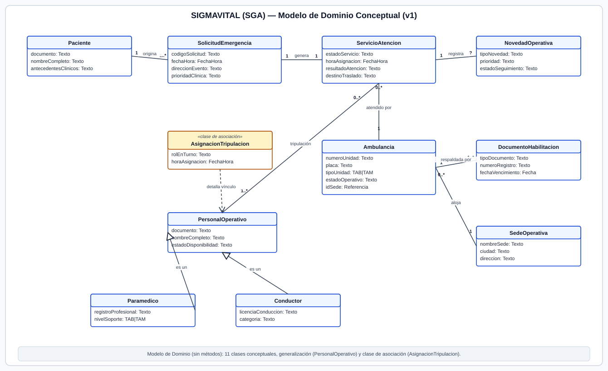
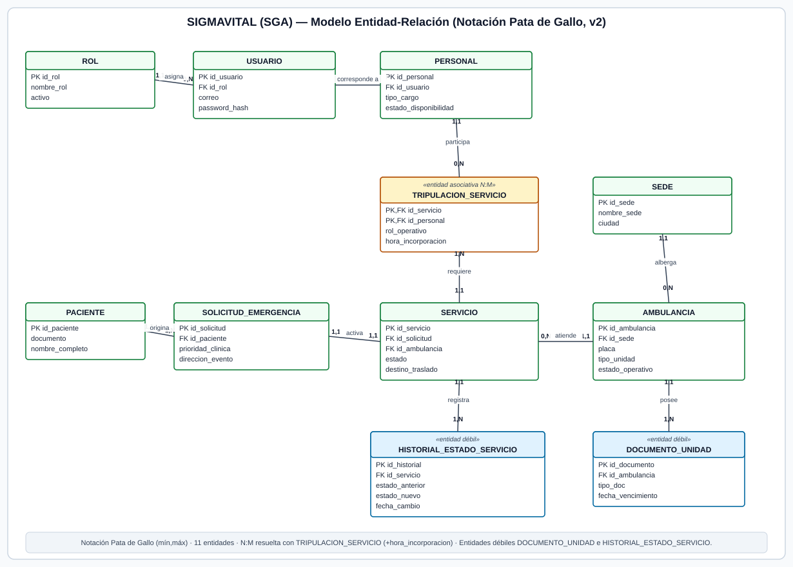

# Guide 1 · Product 2: Analysis Model and Verification Report (English Version)

**Author:** `@darkid8` · **Ficha:** `3413974` (SENA — Software Analysis and Development)  
**Case Study:** **SIGMAVITAL — Ambulance Management System (SGA)**

---

## 1. Extended Use Case Specifications (Business-Intent Level, Zero Technical Implementation Details)

### 1.1 `CU-05 · Register emergency request and patient`
- **Requirements Addressed:** `RF-018`, `RF-019`, `RF-020`, `RF-021`
- **Primary Actor:** Operational Coordinator | **Secondary Actor:** None
- **Preconditions:** The Operational Coordinator is authenticated with an authorized Emergency role (`CU-01`).
- **Trigger:** The Operational Coordinator selects "New Emergency Request" upon receiving an emergency call.
- **Main Success Scenario (8 steps):**
  1. The Operational Coordinator opens the emergency registration form.
  2. The system displays fields for caller information, event location, emergency type, clinical priority, and patient lookup.
  3. The Operational Coordinator enters the patient's identification number to check prior records.
  4. The system retrieves existing patient demographics, emergency contacts, and relevant medical history if registered.
  5. The Operational Coordinator completes or updates patient data, exact location, emergency type, and clinical priority (`Green`, `Yellow`, `Orange`, or `Red`).
  6. The system validates that all required fields are complete and consistent with triage rules.
  7. The Operational Coordinator confirms the emergency request.
  8. The system generates a unique request code, sets its initial status to `Requested` with a timestamp, and enables unit dispatch (`CU-06`).
- **Alternate Flows:**
  - **3a (Unregistered or unidentified critical patient):** The system allows registering a new patient or temporary unidentified emergency record with available data and resumes at step 5.
  - **4a (Prior care history available):** The system displays a summary of previous services (`RF-020`) to support triage classification.
- **Exceptions:**
  - **6a (Incomplete required fields):** If event address, clinical priority, or minimum contact data is missing, the system highlights missing fields with corrective guidance and prevents saving.
- **Postconditions:** The request is stored in `Requested` status linked to the patient, priority level, and reception timestamp.
- **Prototype Screen:** [`PANT-01 · Emergency Request Registration (CU-05)`](../06-mockup-cu05-solicitud.svg)

### 1.2 `CU-06 · Dispatch ambulance to emergency service`
- **Requirements Addressed:** `RF-022`, `RF-023`, `RF-026`, `RN-001`–`RN-004`, `RN-007`
- **Primary Actor:** Operational Coordinator | **Secondary Actor:** Paramedic (notified)
- **Preconditions:** The Operational Coordinator is authenticated with an authorized role and at least one emergency request exists in `Requested` status.
- **Trigger:** The Operational Coordinator selects "Dispatch Unit" on a pending `Requested` emergency.
- **Main Success Scenario (6 steps):**
  1. The Operational Coordinator selects the pending emergency request.
  2. The system invokes mandatory certification validation (`CU-13`) across active ambulances and operational crew.
  3. The system evaluates clinical priority, required unit modality (`TAB` or `TAM`), availability, and proximity, suggesting an optimal ambulance and crew.
  4. The Operational Coordinator reviews the suggested unit and confirms the assignment.
  5. The system records the service assignment in `Assigned` status, updates the ambulance status to `In Service`, and notifies both the real-time operational board and the assigned field crew.
  6. The system records the dispatch transaction in the immutable audit log (`CU-14`).
- **Alternate Flows:**
  - **4a (Manual unit override — `CU-15`):** If the Coordinator selects a different unit than suggested, the system requires a mandatory manual-assignment reason (`RN-007`), verifies `RN-001`/`RN-003`, and resumes at step 5.
  - **4b (Pre-route cancellation — `RF-026`, `RN-006`):** If the Coordinator cancels the request while in `Requested` or `Assigned` status, they enter a mandatory justification; the system sets status to `Cancelled`, audits the event, and closes the case.
- **Exceptions:**
  - **2a (No certified units/crew available):** If no available unit holds valid SOAT, technical inspection, and REPS certification with certified crew (`RN-001`, `RN-003`, `RN-004`), the system blocks automatic dispatch, raises a critical red alert, and keeps the request in `Requested` status for escalation.
  - **4c (Modality mismatch warning — `RN-002`):** If a `TAB` unit is selected for a critical priority case requiring `TAM`, the system displays a regulatory warning requiring explicit confirmation or unit change.
- **Postconditions:** The emergency service is created in `Assigned` status linked to the ambulance and crew, and the ambulance transitions to `In Service`.
- **Prototype Screen:** [`PANT-02 · Smart Dispatch & Real-Time Monitoring (CU-06)`](../06-mockup-cu06-despacho.svg)

### 1.3 `CU-07 · Manage prehospital care and service closure`
- **Requirements Addressed:** `RF-024`, `RF-025`, `RF-027`, `RN-005`, `RN-006`
- **Primary Actor:** Paramedic | **Secondary Actor:** Operational Coordinator
- **Preconditions:** The Paramedic is authenticated and has an active service in `Assigned` status.
- **Trigger:** The Paramedic begins ambulance transit toward the emergency scene.
- **Main Success Scenario (7 steps):**
  1. The Paramedic selects the assigned service and marks the transition to `En Route`.
  2. The system logs the departure timestamp and updates the operational monitoring board.
  3. Upon arriving at the scene, the Paramedic marks `On Scene (In Care)` and records initial clinical assessment (`RF-019`).
  4. When patient transport begins toward a receiving healthcare facility, the Paramedic updates the status to `In Transit`.
  5. Upon patient handover, the Paramedic completes the four mandatory closure fields: care outcome, final patient status, receiving destination, and closing officer (`RN-005`).
  6. The system validates that all four mandatory closure fields are complete and no blocking critical incidents remain open.
  7. The system sets the service status to `Completed`, releases the ambulance and crew back to `Available`, and logs closure in the audit trail (`CU-14`).
- **Alternate Flows:**
  - **3a (Stabilized on scene without hospital transport):** The Paramedic records "On-scene care without transport" as the destination, completes outcome and patient status, and proceeds to step 6.
  - **4a (En-route incident — `CU-16`):** If a vehicle breakdown, delay, or contingency occurs en route, the Paramedic invokes `Report en-route incident (CU-16)` and continues tracking the service.
- **Exceptions:**
  - **6a (Missing mandatory closure fields — `RN-005`):** If any of the four required closure fields is empty, the system blocks closure and highlights the incomplete fields.
  - **6b (Disallowed cancellation in transit — `RN-006`):** If cancellation is attempted while `En Route`, `In Care`, or `In Transit`, the system rejects cancellation and instructs recording an operational incident instead.
- **Postconditions:** The service reaches `Completed` status with full chronological timestamps, and both ambulance and crew return to `Available`.
- **Prototype Screen:** [`PANT-03 · Prehospital Care Log & Closure (CU-07)`](../06-mockup-cu07-cierre.svg)

---

## 2. UML Activity Diagrams (`CU-06` and `CU-07`)

1. **`CU-06` Dispatch Activity Diagram** ([02-actividad-despacho.svg](../02-actividad-despacho.svg)): Models 3 actor swimlanes (`Operational Coordinator`, `SIGMAVITAL System`, `Paramedic`), explicit bracketed guards on every decision branch, and a **Fork/Join synchronization bar** for concurrent real-time dashboard updates and field crew notifications.
2. **`CU-07` Care & Closure Activity Diagram** ([03-actividad-atencion-cierre.svg](../03-actividad-atencion-cierre.svg)): Models 2 swimlanes (`Paramedic`, `SIGMAVITAL System`) and all clinical/closure guards. *Concurrency note:* Care progression is strictly sequential by clinical stage, requiring no internal parallel fork/join.

---

## 3. Conceptual Domain Model & Crow's Foot Conceptual ERD

### 3.1 Conceptual Domain Model (11 Pure Business Classes, Zero Methods, Zero Foreign Keys)

- **11 Conceptual Classes:** `Paciente`, `SolicitudEmergencia`, `ServicioAtencion`, `Ambulancia`, `DocumentoHabilitacion`, `SedeOperativa`, `PersonalOperativo` *(abstract superclass)*, `Paramedico` *(subclass)*, `Conductor` *(subclass)*, `AsignacionTripulacion` *(association class for N:M crew assignment)*, and `NovedadOperativa`.

### 3.2 Conceptual Entity-Relationship Model (Crow's Foot Notation, 11 Entities)

- **11 Entities:** `ROL`, `USUARIO`, `PERSONAL`, `SEDE`, `AMBULANCIA`, `DOCUMENTO_UNIDAD` *(weak entity)*, `PACIENTE`, `SOLICITUD_EMERGENCIA`, `SERVICIO`, `TRIPULACION_SERVICIO` *(associative entity resolving `SERVICIO ↔ PERSONAL` N:M with own attributes `rol_operativo` and `hora_incorporacion`)*, and `HISTORIAL_ESTADO_SERVICIO` *(weak entity tracking every `RF-024` transition)*.

---

## 4. Verification Summary, 5 Corrected Findings, and End-to-End Traceability

- **Checklist Evaluation (`07-verificacion-lista-chequeo-y-ajustes.md`):** 16 verifiable Yes/No criteria (including 5 coverage/traceability checks) were applied. Initial pass v1 scored `11/16`; all **5 findings (`H-01` to `H-05`)** were fixed in commit [`60fbf20`](https://github.com/darkid8/ADSO-3413974/commit/60fbf20) and re-verified to **`16/16 (100%)`**:
  1. `H-01`: Removed technical implementation terms (`WebSocket`, `servicios` table) from `CU-06` template step 5.
  2. `H-02`: Removed runtime ambulance-availability check from `CU-06` preconditions (handled in exception `2a`).
  3. `H-03`: Removed technical FK attribute `idSede` from conceptual class `Ambulancia` and set explicit `1` to `0..*` multiplicity on `NovedadOperativa`.
  4. `H-04`: Added timestamp attribute `hora_incorporacion` to associative entity `TRIPULACION_SERVICIO`.
  5. `H-05`: Added weak entity `HISTORIAL_ESTADO_SERVICIO` to support full state traceability (`RF-024`, `RNF-028`).
- **End-to-End Traceability (`08-informe-analisis-y-trazabilidad.md` Annex C):** Traces **60/65 Functional Requirements (`92.31%`)** across Use Case → Activity/Template → Domain Class → ERD Entity → Labeled Wireframe (`PANT-01` to `PANT-03`).
