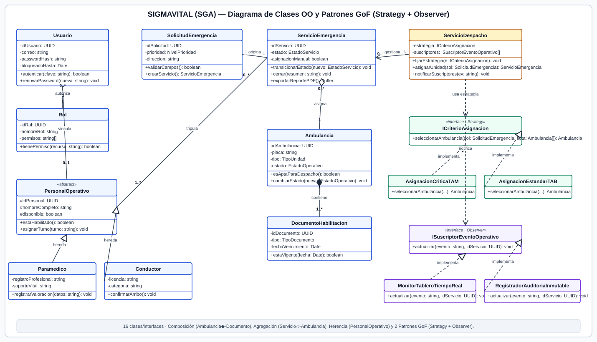
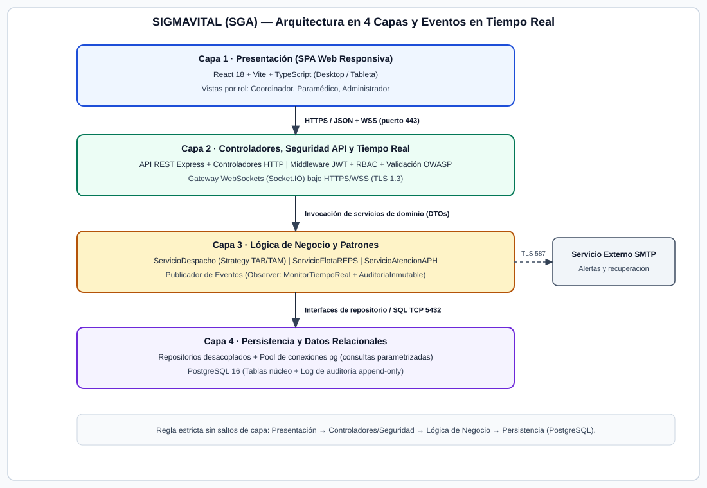
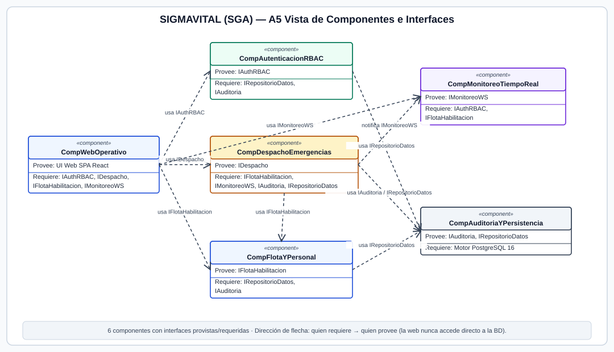
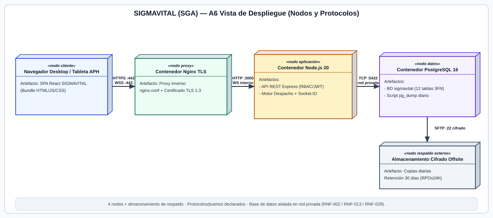

# Guide 2 · Product 1: Object-Oriented Design Artifacts and Software Architecture (English Version)

**Author:** `@darkid8` · **Ficha:** `3413974` (SENA — Software Analysis and Development)  
**Case Study:** **SIGMAVITAL — Ambulance Management System (SGA)**

---

## 1. Analysis Interpretation & Technology Platform Justification (`A1`)

From the team SRS (`65 RF`), `@darkid8` individually designs the core prehospital dispatch, licensing, real-time monitoring, and audit subsystem comprising **14 Functional Requirements** (`RF-002`, `RF-005`, `RF-007`, `RF-008`, `RF-011`, `RF-014`, `RF-016`, `RF-018`, `RF-021`, `RF-022`, `RF-023`, `RF-024`, `RF-028`, `RF-055`) and **5 Non-Functional Requirements** (`RNF-001` salted password hash, `RNF-002` HTTPS/WSS TLS, `RNF-004` Law 1581/2012 sensitive data protection, `RNF-009` automatic dispatch `≤ 2 s`, and `RNF-013` uptime `≥ 97%`).

- **Object-Oriented Language — TypeScript (Node.js + Express Backend & React 18 SPA):**
  1. Static typing for interfaces (`ICriterioAsignacion`, `ISuscriptorEventoOperativo`), abstract classes (`PersonalOperativo`), and clinical enums (`TAB | TAM`).
  2. Event-driven non-blocking I/O with `Socket.IO` for `≤ 2 s` dispatch and real-time operational boards (`RF-028`).
  3. Lightweight Docker container footprint suitable for constrained institutional VPS hardware (`RST-10`).
  4. Mature security ecosystem (`bcrypt`/`argon2`, `jsonwebtoken`, `helmet`) aligned with OWASP controls.
- **Database Engine — Relational SGBD (PostgreSQL 16):**
  1. Strict **ACID transactional locking** prevents double-dispatching the same `Available` ambulance (`RN-001`).
  2. Fixed relational integrity (`1:1`, `1:N`, `N:M`) across requests, services, units, REPS documents, and crews.
  3. Native `CHECK` constraints, `FOREIGN KEY` actions, and append-only audit snapshots (`RN-010`).
  4. Reliable 5-year retention (`RNF-021`) and automated daily `pg_dump` backups (`RNF-029`).

---

## 2. Object-Oriented Class Diagram (`A2`) and GoF Design Patterns (`A3`)

### Key OO Principles Applied (17 Classes & Interfaces)
- **Inheritance (`is-a`):** `Paramedico` and `Conductor` inherit shared state and `+estaHabilitado(): boolean` from abstract `PersonalOperativo`.
- **Composition (`◆`):** `Ambulancia` `1 ◆── 1..*` `DocumentoHabilitacion` (licensing records have no independent lifecycle outside their unit).
- **Aggregation (`◇`):** `ServicioEmergencia` `0..* ◇── 1` `Ambulancia` (ambulances persist independently of individual services).
- **High Cohesion (`B7` refinement):** `ServicioEmergencia` handles only service lifecycle transitions and closure (`RN-005`), while PDF export is isolated in `GeneradorReporteOperativo`.

### Applied Gang of Four (GoF) Design Patterns (2 Non-Singleton Patterns)

| GoF Pattern | Concrete Problem in SIGMAVITAL | Why This Pattern | Implementing Classes | Maintainability Gain |
|---|---|---|---|---|
| **Strategy** *(Behavioral)* | Automatic ambulance selection (`RF-022`) varies by clinical triage: critical emergencies (`Red`/`Orange`) prioritize `TAM` advanced life support, whereas moderate cases (`Yellow`/`Green`) prioritize proximity with `TAB` units (`RN-002`). | Encapsulates interchangeable dispatch algorithms behind a common interface instead of rigid `if/else` blocks inside `ServicioDespacho`. | Context: `ServicioDespacho` Interface: `ICriterioAsignacion` Strategies: `AsignacionCriticaTAM`, `AsignacionEstandarTAB` | New dispatch policies (e.g., traffic-aware or hospital-network routing) can be added as new classes without modifying `ServicioDespacho` (Open/Closed Principle). |
| **Observer** *(Behavioral)* | Every dispatch or state change (`RF-024`) must simultaneously push live updates to the WebSocket monitoring board (`RF-028`) and write an immutable audit entry (`RF-055`) without coupling core domain logic to socket or log infrastructure. | Decouples the event publisher from multiple independent subscribers via a polymorphic notification contract. | Subject: `ServicioDespacho` Interface: `ISuscriptorEventoOperativo` Observers: `MonitorTableroTiempoReal`, `RegistradorAuditoriaInmutable` | Additional subscribers (e.g., SMTP email alerts or KPI aggregators) can be attached without altering transactional dispatch code. |

---

## 3. Layered Software Architecture (`A4`), Component View (`A5`), and Deployment View (`A6`)

### 3.1 Four-Layer Strict Architecture & NFR Decisions (`A4`)

- **Strict Layering (No Layer Skipping):** `Presentation (React SPA) → Controllers/Security (Express + JWT/RBAC + Socket.IO) → Domain Business Logic (Services + Strategy/Observer) → Persistence (Repositories + PostgreSQL)`.
- **Key Architectural Decisions vs. Discarded Alternatives:**
  - `RNF-001`: Adaptive `bcrypt` salted hashing (discarded reversible AES password encryption and unsalted SHA-256).
  - `RNF-002`: Nginx `TLS 1.3` reverse proxy over `:443` (discarded direct HTTP `:3000` exposure).
  - `RNF-004`: Server-side RBAC middleware + encrypted-at-rest clinical columns (discarded frontend-only menu hiding).
  - `RNF-009`: Indexed availability lookup + `Socket.IO` push (discarded 2-second HTTP client polling).
  - `RNF-013` & Style: Modular containerized monolith with healthchecks (discarded distributed microservices due to excessive operational overhead for a 4-developer team).

### 3.2 Component View (`A5` — 6 Components)

- `CompWebOperativo` requires `IAuthRBAC`, `IDespacho`, `IFlotaHabilitacion`, and `IMonitoreoWS`.
- `CompAutenticacionRBAC` (`IAuthRBAC`), `CompDespachoEmergencias` (`IDespacho`), `CompFlotaYPersonal` (`IFlotaHabilitacion`), and `CompMonitoreoTiempoReal` (`IMonitoreoWS`) delegate persistence and immutable logging through `CompAuditoriaYPersistencia` (`IAuditoria`, `IRepositorioDatos`).

### 3.3 Deployment View (`A6` — 4 Execution Nodes + Offsite Backup)

- **Client Node** (Desktop/Tablet Browser) `-- HTTPS :443 / WSS :443 -->` **Reverse Proxy Node** (Nginx TLS 1.3 Container) `-- HTTP :3000 / WS -->` **Application Server Node** (Node.js 20 Container) `-- Private TCP :5432 -->` **Database Node** (PostgreSQL 16 Container, isolated from public Internet) `-- Encrypted SFTP :22 -->` **Offsite Backup Storage** (30-day retention, `RPO ≤ 24 h`, `RTO ≤ 4 h`).

---

## 4. Bidirectional Traceability Summary (`A7`)
All **14/14 Functional Requirements (`100%`)** and **5/5 Non-Functional Requirements (`100%`)** trace forward to specific OO classes, relational tables, and components, and backward verification confirms **0 orphan classes (`17/17`)** and **0 orphan tables (`12/12`)** (see [A7-matriz-trazabilidad.md](../A7-matriz-trazabilidad.md)).
