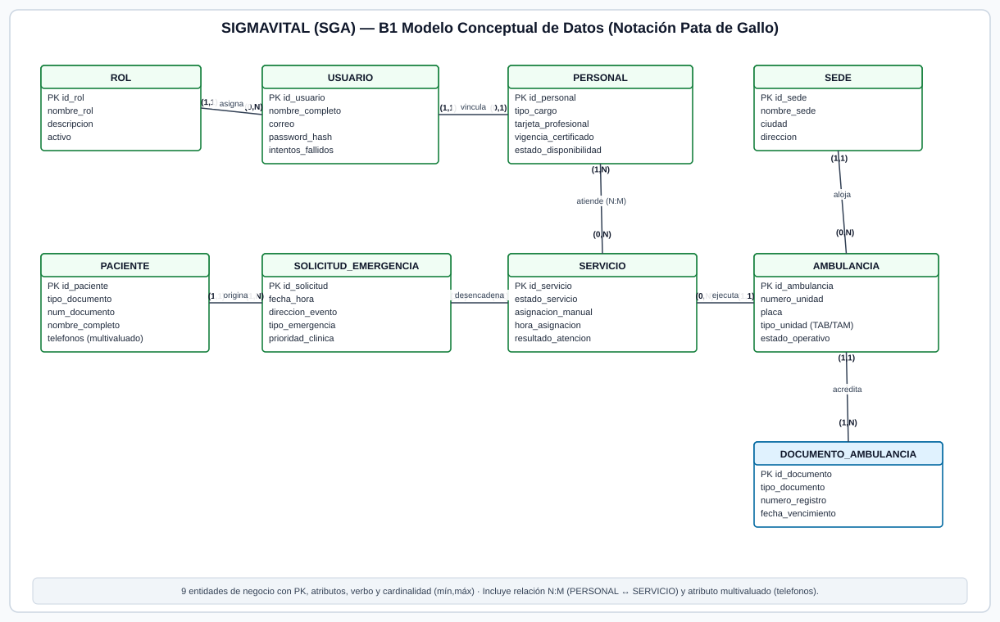
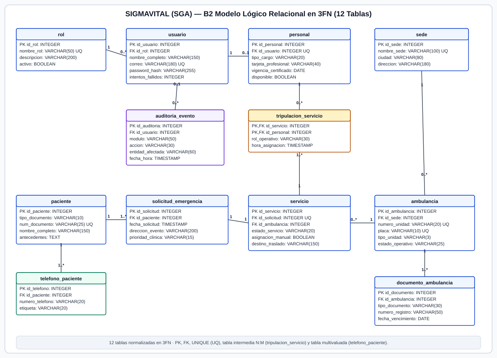

# Guide 2 · Product 2: Relational Data Model, Security Policies, and Design Verification (English Version)

**Author:** `@darkid8` · **Ficha:** `3413974` (SENA — Software Analysis and Development)  
**Case Study:** **SIGMAVITAL — Ambulance Management System (SGA)**

---

## 1. Conceptual Data Model (`B1`) and Logical Relational Model in 3NF (`B2`)

### 1.1 Conceptual Model (9 Core Entities, Crow's Foot `(min,max)` Notation)

- **9 Core Entities:** `ROL`, `USUARIO`, `PERSONAL`, `SEDE`, `AMBULANCIA`, `DOCUMENTO_AMBULANCIA`, `PACIENTE` (with multivalued `telefonos`), `SOLICITUD_EMERGENCIA`, and `SERVICIO` (including `1:1`, `1:N`, and `PERSONAL ↔ SERVICIO` `N:M` relationships).

### 1.2 Logical Relational Model (12 Tables in 3NF) & Transformation Rules

| Transformation Rule | Conceptual Source (`B1`) | Relational Result in `B2` (12 Tables) |
|---|---|---|
| **N:M relationship → Associative table** | `SERVICIO` `(1,N)` ↔ `(0,N)` `PERSONAL` | `tripulacion_servicio(id_servicio PK/FK, id_personal PK/FK, rol_operativo, hora_asignacion)` |
| **1:N relationship → FK on the "many" side** | `ROL→USUARIO`, `SEDE→AMBULANCIA`, `AMBULANCIA→DOCUMENTO`, `PACIENTE→SOLICITUD`, `AMBULANCIA→SERVICIO` | Foreign keys `usuario.id_rol`, `ambulancia.id_sede`, `documento_ambulancia.id_ambulancia`, `solicitud_emergencia.id_paciente`, `servicio.id_ambulancia` |
| **1:1 relationship → `UNIQUE` Foreign Key** | `SOLICITUD_EMERGENCIA (1,1) → (1,1) SERVICIO` and `USUARIO (1,1) → (0,1) PERSONAL` | `servicio.id_solicitud FK UNIQUE` and `personal.id_usuario FK UNIQUE` |
| **Multivalued attribute → Separate table** | Multiple patient/family contact numbers in `PACIENTE` | `telefono_paciente(id_telefono PK, id_paciente FK, numero_telefono, etiqueta)` |
| **Generalization → Single table with discriminator** | `Paramedico` and `Conductor` subtypes of operational staff | `personal` table with `tipo_cargo CHECK (tipo_cargo IN ('PARAMEDICO','CONDUCTOR'))` |

---

## 2. Step-by-Step Normalization Evidence (`0NF → 1NF → 2NF → 3NF` · `B3`)

### Case 1: Composite Primary Key Table (`despacho_tripulacion_0fn`)
- **`0NF`:** `despacho_tripulacion_0fn(id_servicio, id_personal, estado_servicio, id_ambulancia, placa_ambulancia, nombre_personal, tipo_cargo, telefonos_contacto_paciente, rol_operativo, hora_asignacion)` — PK: `(id_servicio, id_personal)`.
- **`1NF` (Atomicity):** Extracted repeating comma-separated phone numbers into `telefono_paciente(id_telefono PK, id_paciente FK, numero_telefono, etiqueta)`.
- **`2NF` (Remove Partial Dependencies on Composite Key):**
  - `FD1 (full): (id_servicio, id_personal) → rol_operativo, hora_asignacion`
  - `FD2 (partial): id_servicio → estado_servicio, id_ambulancia, placa_ambulancia`
  - `FD3 (partial): id_personal → nombre_personal, tipo_cargo`
  - Split into `tripulacion_servicio`, `servicio_2fn`, and `personal`.
- **`3NF` (Remove Transitive Dependencies):**
  - In `servicio_2fn`, `id_servicio → id_ambulancia → placa_ambulancia`. Moved `placa` to `ambulancia(id_ambulancia PK, ...)`, retaining only `id_ambulancia FK` in `servicio`.

### Case 2: Transitive Dependency Table (`ficha_ambulancia_sede_0fn`)
- **`0NF`:** `ficha_ambulancia_sede_0fn(id_ambulancia PK, numero_unidad, placa, tipo_unidad, id_sede, nombre_sede, ciudad_sede, direccion_sede, documentos_vigentes)`.
- **`1NF`:** Extracted repeating `documentos_vigentes` list into `documento_ambulancia(id_documento PK, id_ambulancia FK, tipo_documento, numero_registro, fecha_vencimiento)`.
- **`2NF`:** Single-column primary key (`id_ambulancia`), so no partial dependencies exist.
- **`3NF`:** Eliminated transitive dependency `id_ambulancia → id_sede → nombre_sede, ciudad_sede, direccion_sede` by extracting `sede(id_sede PK, nombre_sede, ciudad, direccion)`.

---

## 3. Data Dictionary (`B4`) and Verified SQL DDL Execution (`B5`)

- **Naming Standard (`B4`):** Singular `snake_case` table names, `id_<table>` primary keys, `100%` column/type/constraint parity between [B4-diccionario-datos.md](../B4-diccionario-datos.md) and [B5-schema-sigmavital.sql](../B5-schema-sigmavital.sql).
- **Real Engine Verification (`B5`):** Executed on `SQLite 3` (`PRAGMA foreign_keys = ON`, `-bail` mode) with **`0` errors**, creating **`12/12` tables**, **`12` `CHECK` constraints**, and **`11` `FOREIGN KEY` constraints with explicit `ON DELETE` rules** (`RESTRICT`, `CASCADE`, `SET NULL`), verified with synthetic relational seed data ([B5-evidencia-ejecucion.log](../B5-evidencia-ejecucion.log)).

---

## 4. Data Security Policies & RBAC Matrix (`B6`)

1. **Integrity (`POL-INT-01`, `POL-INT-02`):** Enforced database-level `PK`, `FK ON DELETE RESTRICT`, and `12 CHECK` constraints; **append-only immutability** on `auditoria_evento` (`INSERT` only; `UPDATE` and `DELETE` revoked for all roles including `Administrador`, `RN-010`).
2. **Confidentiality (`POL-CON-01`, `POL-CON-02`):** Passwords stored exclusively with **salted cryptographic hashing (`bcrypt` cost 12 / `Argon2id`)** —never reversible encryption or plaintext—; all traffic encrypted via **TLS 1.3 (`HTTPS :443` / `WSS :443`)**; patient records (`paciente`, `telefono_paciente`) governed by **Colombian Law 1581 of 2012** (informed purpose, prior holder authorization, RBAC filtering, and `AES-256` encryption at rest on `paciente.antecedentes`).
3. **Availability (`POL-DIS-01`, `POL-DIS-02`):** Automated daily encrypted `pg_dump` transferred via `SFTP :22` to offsite storage with 30-day retention (`RPO ≤ 24 h`, `RTO ≤ 4 h`) plus scheduled **monthly restoration drills** documented via formal verification minutes.
4. **RBAC Table Matrix:** Explicit `SELECT / INSERT / UPDATE / DELETE` permissions defined across all 12 tables for `Administrador`, `Coordinador Operativo`, `Paramédico`, and `Analista Directivo` (see [B6-politicas-seguridad-y-roles.md](../B6-politicas-seguridad-y-roles.md)).

---

## 5. Design Verification Checklist & Findings (`B7`)

Applied **24 measurable acceptance criteria** grouped by artifact category (`Classes`, `Patterns`, `Architecture`, `Components`, `Deployment`, `Data Model`, `Dictionary & SQL`, `Security`) with severity levels (`Critical`, `Major`, `Minor`) across both `G2-P1` and `G2-P2`, documenting and resolving **4 design findings (`H-01` to `H-04`)**, including extracting `GeneradorReporteOperativo` from `ServicioEmergencia` in commit [`b660e8f`](https://github.com/darkid8/ADSO-3413974/commit/b660e8f) (`24/24` criteria met — `100%`).
